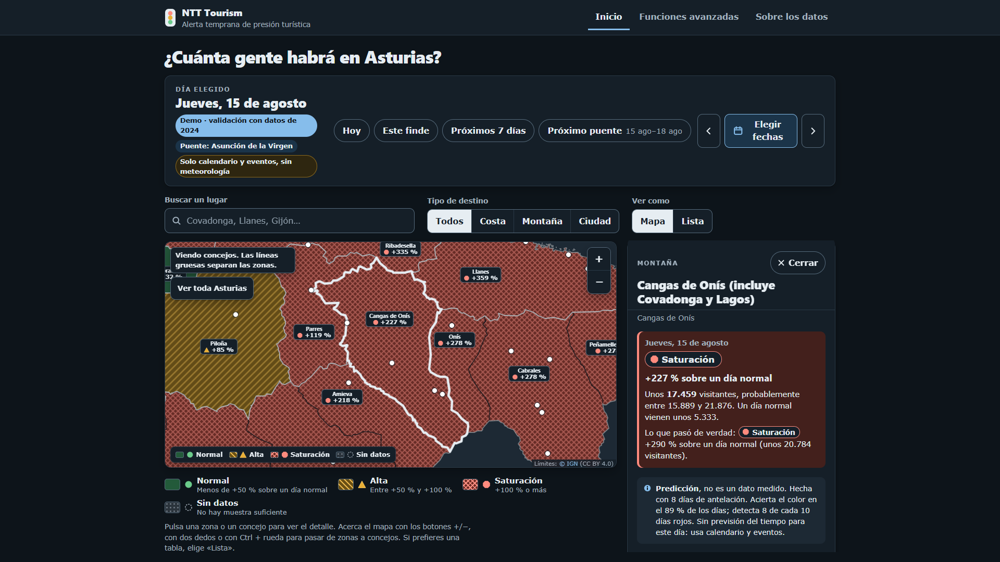

# NTT Tourism: alerta temprana de presión turística en Asturias

Proyecto para el **Hackathon TalentUO 2026** (Universidad de Oviedo), reto de NTT DATA «Predicción de afluencia turística en Asturias». «NTT Tourism» es el nombre del proyecto del equipo: no es un producto ni un servicio oficial de NTT DATA.

**Demo:** <https://ntt-tourism.vercel.app>



## Contenido

1. [Qué es](#qué-es)
2. [Resultados](#resultados)
3. [Cómo funciona](#cómo-funciona)
4. [Instalación](#instalación)
5. [Uso rápido](#uso-rápido)
6. [Reproducir desde cero](#reproducir-desde-cero)
7. [Estructura del repositorio](#estructura-del-repositorio)
8. [Limitaciones](#limitaciones)
9. [Fuentes de datos y licencias](#fuentes-de-datos-y-licencias)
10. [Documentación](#documentación)
11. [Equipo y créditos](#equipo-y-créditos)
12. [Licencia](#licencia)

## Qué es

Un sistema de alerta temprana de presión turística para la administración: ayuntamientos, Principado y Parque Nacional de los Picos de Europa.

- **Qué predice:** para cada día y cada una de las **46 zonas del MITMA en Asturias** (los 78 concejos), cuántos visitantes de ocio llegarán y cuánto supone frente a un **día normal** de esa zona. El día normal es la mediana de ese día de la semana en 2024, sin julio, agosto ni festivos.
- **Cómo lo muestra:** como un semáforo (verde, ámbar a partir de 1,5 veces lo normal, rojo a partir de 2), con los tres factores que más pesan en cada predicción.
- **Con qué datos:** aprende de los viajes diarios del MITMA (2022-01-01 → 2025-06-30). Usa como factores lo que se conoce de antemano: festivos de Asturias y de las comunidades de origen, puentes, vacaciones escolares, eventos y partidos, previsión del tiempo e interés en internet.
- **Zona principal:** la puerta de los Picos de Europa (Cangas de Onís, con Covadonga y los Lagos).

## Resultados

Salidas actuales en `salidas/`: datos reales (`sintetico: false`), 46 zonas, algoritmo **XGBoost**, generadas el 2026-10-16 a las 10:30. Validación fuera de muestra por bloques semestrales (2023-S2, 2024-S1, 2024-S2 y 2025-S1).

**Error y detección de días rojos**, todos los bloques y zonas (`salidas/metricas.json → tablas.global`, experimento `base`):

| | Corto plazo (1-7 días) | Largo plazo (8 o más días) |
|---|---|---|
| Error en visitantes (WAPE) del modelo | **9,7 %** | **9,9 %** |
| WAPE de suponer un día normal (B0) | 12,9 % | 12,9 % |
| WAPE de repetir el mismo día del año anterior (B1) | 10,9 % | 10,9 % |
| Acierto del color del semáforo | 94,0 % | 94,5 % |
| Días rojos detectados (recall) | 54,7 % | 68,7 % |
| Precisión de los avisos rojos | 88,6 % | 85,2 % |
| Recall / precisión de B1, como referencia | 70,2 % / 74,1 % | 70,2 % / 74,1 % |

B1 no se puede desplegar, porque el MITMA no publica en tiempo real. Aun así detecta más días rojos que el modelo, aunque con más falsas alarmas.

**Zona de los Picos (Cangas de Onís, 33012):**

- A largo plazo detecta **66 de los 87 días rojos** de la validación, con un 93 % de precisión (`salidas/metricas.json → tablas.zona`).
- Días por encima de 2 veces lo normal: **39 en 2023 y 48 en 2024**. 85 de esos 87 ya caían en días de acceso regulado a los Lagos (`salidas/regulacion.json → lagos`).
- Previsión: **40 días rojos en 2026 (entre 27 y 72) y 30 en 2027 (entre 24 y 62)** (`salidas/regulacion.json → por_zona`).
- El calendario de regulación de los Lagos se parece más a «cualquier día un 10 % por encima de lo normal» (umbral de 1,10×, F1 0,87) que a los días de presión extrema (`salidas/calibracion_lagos.json`).

**Algoritmo:** XGBoost, elegido frente a LightGBM con una regla fijada antes de ver los datos reales. Detecta más días rojos en verano (64,2 % frente a 53,9 %) con una precisión 1,4 puntos menor (`salidas/resumen_ejecucion.json → seleccion_algoritmo`, `salidas/comparacion_algoritmos.json`).

**Factores que más pesan** (`salidas/explicacion_factores.json`):
- largo plazo: zona, época del año, vacaciones escolares y acceso regulado a los Lagos;
- corto plazo: además, el interés en internet.

Detalle del modelo y de la validación en `notas/modelo.md`; paso de 5 a 46 zonas en `notas/ampliacion_zonas.md`.

## Cómo funciona

```text
MITMA (viajes y pernoctaciones) ──► objetivo diario por zona (llegadas de ocio)
Calendarios, eventos, partidos,  ─┐
tiempo previsto, Wikipedia/Trends ─┴► factores por zona y día (sin datos posteriores a la predicción)
                                        │
                                        ▼
               dos modelos XGBoost: largo plazo (8+ días, solo calendario y eventos)
                                    corto plazo (1-7 días, + tiempo e interés en internet)
                                        │  validación por bloques, B0 y B1, SHAP, intervalos p10-p90
                                        ▼
               JSON en salidas/ ──► web estática (Afluencia Asturias/)
```

- **Sin fuga de información:** para predecir el día d con h días de antelación solo se usa lo publicado hasta d−h. Lo comprueba una prueba automática (`src/modelo/tests/test_antifuga.py`).
- **Tiempo:** solo la previsión archivada, a 1-3 días y desde el 2024-01-22; nunca la observación.
- **Contratos:** entrada en `notas/contrato_objetivo.md`; salidas para la web en `notas/contrato_web.md`.

## Instalación

Python 3.11.

```bash
python -m venv .venv
.venv\Scripts\activate          # Windows (PowerShell o cmd)
# source .venv/bin/activate     # macOS o Linux
pip install -r requirements.txt
```

`requirements-lock.txt` recoge versiones exactas probadas.

La extracción de texto de los PDF de calendarios usa `pdftotext` (poppler); solo hace falta para volver a descargarlos.

Variables de entorno, ninguna se guarda en el repositorio:

| Variable | Para qué |
|---|---|
| `AEMET_API_KEY` | Descargas de AEMET OpenData |
| `TALENTUO_CONTACTO` | Contacto en el User-Agent de las descargas (Wikimedia lo pide); si no está, se usa «equipo TalentUO» |

## Uso rápido

```bash
# Abrir la web en local (solo biblioteca estándar): http://127.0.0.1:8000/
python scripts/servir_web.py
python scripts/servir_web.py --demo      # validación con datos de agosto de 2024

# Regenerar las salidas del modelo con los datos reales (unos 15 min) y copiarlas a la web
python -X utf8 src/modelo/ejecutar.py --objetivo real --algoritmo ambos
python -X utf8 scripts/actualizar_datos_web.py

# Pruebas: anti-fuga, constructor del objetivo, regla de elección y contrato de la web
python -X utf8 -m pytest -q -m "not lento" src/modelo/tests   # rápidas
python -X utf8 -m pytest -q src/modelo/tests                  # todas (incluye la cadena completa con cada algoritmo)
```

La web también se abre con doble clic en `Afluencia Asturias/index.html`. Cómo se actualiza y se publica en Vercel: `README_web.md`.

`--objetivo sintetico` ejecuta la misma cadena con un objetivo inventado de efectos conocidos. Sirve para comprobar que el modelo recupera los factores (`notas/modelo.md`).

## Reproducir desde cero

1. **Factores (parte B):** las tablas limpias ya están en `data/clean/`. Para rehacerlas desde `data/raw/`, ejecutar `python -X utf8 src/limpieza_B/ejecutar_todo.py` (unos 50 s; se detiene si falla alguna comprobación). Diccionario en `notas/diccionario_B.md` y control de calidad en `notas/control_calidad_B.md`.
2. **Previsión del tiempo (opcional):** `python -X utf8 src/modelo/descargar_prevision.py` descarga la previsión de 7 días de Open-Meteo de hoy.
3. **Objetivo del MITMA:** `data/clean/objetivo_diario.parquet` ya está versionado. Para rehacerlo hacen falta unos 27 GB de ficheros del MITMA, que no se suben; se descargan siguiendo `notas/fuentes/mitma/descarga_mitma.md` y `notas/modelo.md` («Cómo regenerar el objetivo real»).
4. **Modelo y web:** las dos órdenes de «Uso rápido».

Qué ficheros pesados no están en el repositorio y cómo obtenerlos: `data/raw/LEEME_datos_no_versionados.md`.

## Estructura del repositorio

| Ruta | Contenido |
|---|---|
| `src/descarga_*.py` | Descargas de los factores: AEMET, Open-Meteo, calendarios y señales |
| `src/auditoria/` | Comprobaciones de los datos en bruto de los factores |
| `src/limpieza_B/` | Limpieza de los factores y unión por zona (`unir_B.py`) |
| `src/modelo/` | Objetivo, variables, validación, SHAP, salidas para la web y pruebas (`tests/`) |
| `scripts/` | Descarga y verificación del MITMA, INE y SADEI; copia de las salidas a la web (`actualizar_datos_web.py`); servidor local (`servir_web.py`); tablas y comprobaciones de resultados |
| `config/` | Zonas (`mapeo_zonas.csv`, 46 zonas), puntos meteorológicos, comarcas, semáforo, factores y configuración del modelo |
| `data/raw/` | Datos tal como se descargaron (no se editan a mano) |
| `data/manual/` | Datos recopilados a mano (eventos) |
| `data/clean/` | Tablas limpias de los factores y objetivo del MITMA |
| `data/prevision/` | Previsiones de Open-Meteo en bruto, por fecha de emisión |
| `salidas/` | Salidas del modelo: JSON de la web, `backtest.parquet`, figuras y tablas |
| `Afluencia Asturias/` | Web estática (HTML, CSS y JavaScript sin compilación); documentación en su `README.md` |
| `notas/` | Documentación del proyecto; índice en `notas/README.md` |

## Limitaciones

- **Sin visitantes extranjeros:** el MITMA solo cuenta residentes en España.
- **Datos diarios solo hasta junio de 2025:** desde julio de 2025 cambia la metodología del MITMA y no se mezcla.
- **El umbral del semáforo (1,5× y 2,0×) lo hemos definido nosotros.** No es una capacidad oficial. Además, el MITMA mide llegadas al concejo, no accesos a los Lagos.
- **Cruceros fuera:** no hay escalas realizadas por fecha para 2022-2024.
- **Se queda corto en volumen** en todos los bloques: entre −1,2 % y −6,7 % del total, y en los Picos hasta −15,7 % en el verano de 2024 (`salidas/backtest.parquet`). No hay ninguna variable de tendencia. La previsión de días rojos probablemente cuenta de menos.
- **A corto plazo detecta menos días rojos que el largo plazo** (54,7 % frente a 68,7 %) **y que B1** (70,2 %). El tiempo solo entra a 1-3 días.
- **Intervalos p10-p90 algo estrechos:** cubren de media el 74,8 % de los días reales, frente al 80 % buscado (`metricas.json → fiabilidad`).
- **Falla en los puentes de diciembre** (2023 y 2024).
- **17 de las 46 zonas**, entre ellas Gijón y Oviedo, no tuvieron ningún día rojo observado en 2023 ni en 2024: en las ciudades el semáforo casi siempre está en verde.
- **2027:** el curso escolar desde septiembre y la regulación de los Lagos se suponen iguales a los de 2026.
- **Los factores son asociaciones, no causas.**
- **La validación externa con el INE no se ha hecho.**

## Fuentes de datos y licencias

Fuentes principales: MITMA (Open Data Movilidad), AEMET, Open-Meteo (CC BY 4.0), BOE, BOPA y calendarios escolares, INE, SADEI, OAPN, Wikipedia (Wikimedia), Google Trends, webs de eventos, IGN (CC BY 4.0, límites del mapa), Wikimedia Commons (fotos) y OpenStreetMap (ODbL).

Uso, condiciones de reutilización y texto de atribución de cada una: **`FUENTES_Y_LICENCIAS.md`**.

## Documentación

| Documento | Contenido |
|---|---|
| `notas/modelo.md` | Decisiones del modelo, variables, validación, regla de elección y limitaciones |
| `notas/ampliacion_zonas.md` | Paso de 5 a 46 zonas y arreglo de la parada temprana |
| `notas/contrato_objetivo.md`, `notas/contrato_web.md` | Formato de la entrada (objetivo) y de las salidas para la web |
| `notas/diccionario_B.md`, `notas/control_calidad_B.md` | Diccionario y control de calidad de los factores |
| `notas/guion_modelo.md` | El modelo en un minuto, para la presentación |
| `README_web.md` | Web: datos, arranque, demo, actualización y despliegue |
| `notas/fuentes/` | Registro y decisiones de cada fuente de datos |
| `notas/historico/` | Notas de trabajo de fases ya superadas |
| `notas/README.md` | Índice completo |

## Equipo y créditos

Equipo del Hackathon TalentUO 2026, reto de NTT DATA:

- Hugo Gómez ([@hugoomez](https://github.com/hugoomez))
- Adrián Fernández López ([@adrian-fzl-data](https://github.com/adrian-fzl-data))
- L. Rodríguez Torres ([@LRodriguezTorres](https://github.com/LRodriguezTorres))
- [@antoniocigales](https://github.com/antoniocigales)
- [@sggg6](https://github.com/sggg6)

## Licencia

El código se publica con licencia MIT (`LICENSE`).

Los datos y las imágenes de terceros conservan su propia licencia (`FUENTES_Y_LICENCIAS.md`).
