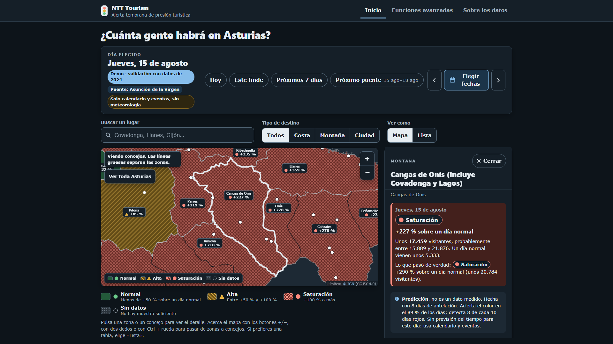

# NTT Tourism: alerta temprana de presión turística en Asturias

- **Qué es:** un producto mínimo viable, desarrollado en el **Hackathon TalentUO 2026** (Universidad de Oviedo, reto de NTT DATA «Predicción de afluencia turística en Asturias»), que avisa con antelación de los días de mucha presión turística en cada zona de Asturias.
- **Resultado principal:** en la validación con días que el modelo no había visto, se desvía un 9,7 % en el número de visitantes (WAPE: error absoluto total dividido entre el total de visitantes), frente al 12,9 % de suponer siempre un día normal (B0). Con más de una semana de antelación detecta 66 de los 87 días rojos de los Picos de Europa (recall: parte de los días rojos reales que el modelo avisa).
- **Para quién:** quien gestiona la afluencia (ayuntamientos, Principado y Parque Nacional de los Picos de Europa) y quien planea una visita.

Es un prototipo de hackathon, no un servicio en producción: lo que le falta está en [Limitaciones](#limitaciones) y [Próximos pasos](#próximos-pasos). «NTT Tourism» es el nombre del proyecto del equipo: no es un producto ni un servicio oficial de NTT DATA.

[](https://github.com/TalentUO/TalentUO/actions/workflows/ci.yml)

**Demo:** <https://ntt-tourism.vercel.app>



## Contenido

1. [Qué es](#qué-es)
2. [Resultados](#resultados)
3. [Cómo funciona](#cómo-funciona)
4. [Instalación](#instalación)
5. [Uso rápido](#uso-rápido)
6. [Reproducir desde cero](#reproducir-desde-cero)
7. [Estructura del repositorio](#estructura-del-repositorio)
8. [Limitaciones](#limitaciones)
9. [Próximos pasos](#próximos-pasos)
10. [Fuentes de datos y licencias](#fuentes-de-datos-y-licencias)
11. [Documentación](#documentación)
12. [Equipo y créditos](#equipo-y-créditos)
13. [Licencia](#licencia)

## Qué es

Un sistema de alerta temprana de presión turística para la administración: ayuntamientos, Principado y Parque Nacional de los Picos de Europa.

- **Qué predice:** para cada día y cada una de las **46 zonas del MITMA en Asturias** (los 78 concejos), cuántos visitantes de ocio llegarán y cuánto supone frente a un **día normal** de esa zona. El día normal es la mediana de ese día de la semana en 2024, sin julio, agosto ni festivos.
- **Cómo lo muestra:** como un semáforo (verde, ámbar a partir de 1,5 veces lo normal, rojo a partir de 2), con los tres factores que más pesan en cada predicción.
- **Con qué datos:** aprende de los viajes diarios del MITMA (2022-01-01 → 2025-06-30). Usa como factores lo que se conoce de antemano: festivos de Asturias y de las comunidades de origen, puentes, vacaciones escolares, eventos y partidos, previsión del tiempo e interés en internet.
- **Zona principal:** la puerta de los Picos de Europa (Cangas de Onís, con Covadonga y los Lagos).

## Resultados

Salidas actuales en `salidas/`: datos reales (`sintetico: false`), 46 zonas, algoritmo **XGBoost**, generadas el 2026-10-16 a las 10:30. Validación fuera de muestra por bloques semestrales (2023-S2, 2024-S1, 2024-S2 y 2025-S1). La web enseña esa previsión, calculada el 2026-10-16, y lo dice en un aviso (`README_web.md`).

Términos de la tabla: **WAPE**, error absoluto total dividido entre el total de visitantes; **B0**, suponer que todos los días son un día normal; **B1**, repetir el mismo día de la semana del año anterior (364 días antes); **recall**, parte de los días rojos reales que se avisan; **precisión**, parte de los avisos rojos que aciertan.

**Error y detección de días rojos**, todos los bloques y zonas (`salidas/metricas.json → tablas.global`, experimento `base`):

| | Corto plazo (1-7 días) | Largo plazo (8 o más días) |
|---|---|---|
| Error en visitantes (WAPE) del modelo | **9,7 %** | **9,9 %** |
| WAPE de suponer un día normal (B0) | 12,9 % | 12,9 % |
| WAPE de repetir el mismo día del año anterior (B1) | 10,9 % | 10,9 % |
| Acierto del color del semáforo | 94,0 % | 94,5 % |
| Días rojos detectados (recall) | 54,7 % | 68,7 % |
| Precisión de los avisos rojos | 88,6 % | 85,2 % |
| Recall / precisión de B1, como referencia | 70,2 % / 74,1 % | 70,2 % / 74,1 % |

B1 no se puede desplegar, porque el MITMA no publica en tiempo real. En esta tabla detecta más días rojos que el modelo, con más falsas alarmas, pero **la comparación no es sobre los mismos días**: B1 solo se evalúa donde hubo dato 364 días antes (a corto plazo, 227.010 filas frente a las 229.264 del modelo) y los días que le faltan incluyen la Semana Santa de 2025.

**Zona de los Picos (Cangas de Onís, 33012):**

- A largo plazo detecta **66 de los 87 días rojos** de la validación, con un 93 % de precisión (`salidas/metricas.json → tablas.zona`).
- Días por encima de 2 veces lo normal: **39 en 2023 y 48 en 2024**. 85 de esos 87 ya caían en días de acceso regulado a los Lagos (`salidas/regulacion.json → lagos`).
- Previsión: **40 días rojos en 2026 (entre 27 y 72) y 30 en 2027 (entre 24 y 62)** (`salidas/regulacion.json → por_zona`).
- El calendario de regulación de los Lagos se parece más a «cualquier día un 10 % por encima de lo normal» (umbral de 1,10×, F1 0,87) que a los días de presión extrema (`salidas/calibracion_lagos.json`).

**Algoritmo:** XGBoost, elegido frente a LightGBM con una regla fijada antes de ver los datos reales. Detecta más días rojos en verano (64,2 % frente a 53,9 %) con una precisión 1,4 puntos menor (`salidas/resumen_ejecucion.json → seleccion_algoritmo`, `salidas/comparacion_algoritmos.json`).

**Factores que más pesan** (`salidas/explicacion_factores.json`):
- largo plazo: zona, época del año, vacaciones escolares y acceso regulado a los Lagos;
- corto plazo: además, el interés en internet.

El «acceso regulado a los Lagos» vale lo mismo en las 46 zonas cada día, así que fuera de Cangas de Onís no mide la regulación: el modelo lo usa como indicador de temporada alta. Con «Partido» pasa lo mismo fuera de Gijón y Oviedo. La web solo los enseña como causa en esas zonas.

Detalle del modelo y de la validación en `notas/modelo.md`; paso de 5 a 46 zonas en `notas/ampliacion_zonas.md`.

## Cómo funciona

```text
MITMA (viajes y pernoctaciones) ──► objetivo diario por zona (llegadas de ocio)
Calendarios, eventos, partidos,  ─┐
tiempo previsto, Wikipedia/Trends ─┴► factores por zona y día (sin datos posteriores a la predicción)
                                        │
                                        ▼
               dos modelos XGBoost: largo plazo (8+ días, solo calendario y eventos)
                                    corto plazo (1-7 días, + tiempo e interés en internet)
                                        │  validación por bloques, B0 y B1, SHAP, intervalos p10-p90
                                        ▼
               JSON en salidas/ ──► web estática (Afluencia Asturias/)
```

- **Sin fuga de información:** para predecir el día d con h días de antelación solo se usa lo publicado hasta d−h. Lo comprueba una prueba automática (`src/modelo/tests/test_antifuga.py`).
- **Tiempo:** solo la previsión archivada, a 1-3 días y desde el 2024-01-22; nunca la observación.
- **Contratos:** entrada en `notas/contrato_objetivo.md`; salidas para la web en `notas/contrato_web.md`.

## Instalación

Python 3.11.

```bash
python -m venv .venv
.venv\Scripts\activate          # Windows (PowerShell o cmd)
# source .venv/bin/activate     # macOS o Linux
pip install -r requirements.txt
```

Otras formas de instalar, según para qué:

```bash
pip install -r requirements-lock.txt                           # las versiones exactas probadas (las que usa la integración continua)
pip install -r requirements-lock.txt -r requirements-dev.txt   # además, lint (ruff), pruebas y herramientas de la web
```

- `requirements-dev.txt` trae lo que no hace falta para ejecutar el modelo ni la web: `ruff`, `pytest` y los paquetes de `Afluencia Asturias/herramientas/` (`topojson`, `shapely` y `Pillow`), que solo se usan para regenerar el mapa y las fichas de los sitios.
- `pdftotext` es un programa del sistema, no un paquete de Python. Solo hace falta para volver a descargar los PDF de calendarios (`src/descarga_calendarios.py`). Viene con poppler: `sudo apt install poppler-utils` (Debian o Ubuntu), `brew install poppler` (macOS) o `conda install -c conda-forge poppler` (Windows).
- Para abrir la web no hace falta instalar nada: `scripts/servir_web.py` solo usa la biblioteca estándar.

Variables de entorno, ninguna se guarda en el repositorio:

| Variable | Para qué |
|---|---|
| `AEMET_API_KEY` | Descargas de AEMET OpenData |
| `TALENTUO_CONTACTO` | Contacto en el User-Agent de las descargas (Wikimedia lo pide); si no está, se usa «equipo TalentUO» |

## Uso rápido

```bash
# Abrir la web en local (solo biblioteca estándar): http://127.0.0.1:8000/
python scripts/servir_web.py
python scripts/servir_web.py --demo      # validación con datos de agosto de 2024

# Regenerar las salidas del modelo con los datos reales (unos 15 min) y copiarlas a la web
python -X utf8 src/modelo/ejecutar.py --objetivo real --algoritmo ambos
python -X utf8 scripts/actualizar_datos_web.py

# Pruebas: anti-fuga, constructor del objetivo, regla de elección y contrato de la web
python -X utf8 -m pytest -q -m "not lento" src/modelo/tests   # rápidas
python -X utf8 -m pytest -q src/modelo/tests                  # todas (incluye la cadena completa con cada algoritmo)
```

La web también se abre con doble clic en `Afluencia Asturias/index.html`. Cómo se actualiza y se publica en Vercel: `README_web.md`.

`--objetivo sintetico` ejecuta la misma cadena con un objetivo inventado de efectos conocidos. Sirve para comprobar que el modelo recupera los factores (`notas/modelo.md`).

## Reproducir desde cero

1. **Factores (parte B):** las tablas limpias ya están en `data/clean/`. Para rehacerlas desde `data/raw/`, ejecutar `python -X utf8 src/limpieza_B/ejecutar_todo.py` (unos 50 s; se detiene si falla alguna comprobación). Diccionario en `notas/diccionario_B.md` y control de calidad en `notas/control_calidad_B.md`.
   - Solo lee ficheros que siguen en el repositorio, así que debería funcionar en un clon limpio. Está comprobado leyendo el código; la cadena entera no se ha ejecutado en un clon limpio (la integración continua solo ejecuta `test_unir_B.py`).
   - Rehace las tablas **con la descarga del 2026-10-15**. Las fechas finales y varios recuentos están fijos en el código (por ejemplo, `WIKI_FIN` en `limpia_senales.py`): si se vuelve a descargar una fuente, la limpieza falla hasta que se actualicen.
2. **Previsión del tiempo (opcional):** `python -X utf8 src/modelo/descargar_prevision.py` descarga la previsión de 7 días de Open-Meteo de hoy.
3. **Objetivo del MITMA:** `data/clean/objetivo_diario.parquet` ya está versionado. Para rehacerlo hacen falta unos 27 GB de ficheros del MITMA, que no se suben; se descargan siguiendo `notas/fuentes/mitma/descarga_mitma.md` y `notas/modelo.md` («Cómo regenerar el objetivo real»).
4. **Modelo y web:** las dos órdenes de «Uso rápido».

Qué ficheros no están en el repositorio, por tamaño o por licencia, y cómo obtenerlos: `data/raw/LEEME_datos_no_versionados.md`.

## Estructura del repositorio

| Ruta | Contenido |
|---|---|
| `src/descarga_*.py` | Descargas de los factores: AEMET, Open-Meteo, calendarios y señales |
| `src/auditoria/` | Comprobaciones de los datos en bruto de los factores |
| `src/limpieza_B/` | Limpieza de los factores y unión por zona (`unir_B.py`) |
| `src/modelo/` | Objetivo, variables, validación, SHAP, salidas para la web y pruebas (`tests/`) |
| `scripts/` | Descarga y verificación del MITMA, INE y SADEI; copia de las salidas a la web (`actualizar_datos_web.py`); servidor local (`servir_web.py`); tablas y comprobaciones de resultados |
| `config/` | Zonas (`mapeo_zonas.csv`, 46 zonas), puntos meteorológicos, comarcas, semáforo, factores y configuración del modelo |
| `data/raw/` | Datos tal como se descargaron (no se editan a mano) |
| `data/manual/` | Datos recopilados a mano (eventos) |
| `data/clean/` | Tablas limpias de los factores y objetivo del MITMA |
| `data/prevision/` | Previsiones de Open-Meteo en bruto, por fecha de emisión |
| `salidas/` | Salidas del modelo: JSON de la web, `backtest.parquet`, figuras y tablas |
| `Afluencia Asturias/` | Web estática (HTML, CSS y JavaScript sin compilación); documentación en su `README.md` |
| `notas/` | Documentación del proyecto; índice en `notas/README.md` |

## Limitaciones

Es un producto mínimo viable hecho en los días del hackathon. Esto es lo que hay que saber antes de fiarse de una cifra.

### Datos y alcance

- **Sin visitantes extranjeros:** el MITMA solo cuenta residentes en España.
- **Datos diarios solo hasta junio de 2025:** desde julio de 2025 cambia la metodología del MITMA y no se mezcla.
- **El umbral del semáforo (1,5× y 2,0×) lo hemos definido nosotros.** No es una capacidad oficial. Además, el MITMA mide llegadas al concejo, no accesos a los Lagos.
- **Cruceros fuera:** no hay escalas realizadas por fecha para 2022-2024.
- **Se queda corto en volumen** en todos los bloques: entre −1,2 % y −6,7 % del total, y en los Picos hasta −15,7 % en el verano de 2024 (`salidas/backtest.parquet`). No hay ninguna variable de tendencia. La previsión de días rojos probablemente cuenta de menos.
- **A corto plazo detecta menos días rojos que el largo plazo** (54,7 % frente a 68,7 %) **y que B1** (70,2 %). El tiempo solo entra a 1-3 días.
- **Intervalos p10-p90 algo estrechos:** cubren de media el 74,8 % de los días reales, frente al 80 % buscado (`metricas.json → fiabilidad`).
- **Falla en los puentes de diciembre** (2023 y 2024).
- **17 de las 46 zonas**, entre ellas Gijón y Oviedo, no tuvieron ningún día rojo observado en 2023 ni en 2024: en las ciudades el semáforo casi siempre está en verde.
- **2027:** el curso escolar desde septiembre y la regulación de los Lagos se suponen iguales a los de 2026.
- **Los factores son asociaciones, no causas.**
- **La validación externa con el INE no se ha hecho.**

### Validación del modelo

- **Mide un caso más fácil que el uso real.** En la validación pasan de 0 a 6 meses entre el último dato y el día previsto; en lo que publica la web, de 16 a 28 meses (datos hasta junio de 2025, previsión de octubre de 2026 a octubre de 2027). Además, en la validación el día normal se recalcula con los 365 días anteriores a cada bloque y en producción es la mediana de 2024. El error real será mayor que el de la tabla de «Resultados», y no hay ninguna cifra que lo mida.
- **No queda un conjunto de prueba sin tocar.** Los mismos 4 bloques sirvieron para elegir el algoritmo, para ajustar un parámetro (los días de validación interna, de 90 a 365) y para dar las cifras finales. La regla de elección estaba fijada de antemano, lo que reduce el problema sin eliminarlo: las cifras son optimistas.
- **El recall global lo decide el verano.** A largo plazo es del 74 % y el 69 % en los dos veranos, pero del **22 % en 2024-S1 y del 44 % en 2025-S1** (`salidas/metricas.json → tablas.bloque`). El 68,7 % no describe la Semana Santa ni los puentes, que es cuando más sirve un aviso con antelación.
- **La comparación con B1 no es sobre las mismas filas** (ver «Resultados»).
- **El rango p10-p90 sale desplazado en 4 zonas** (Allande y 3 más, Coaña, El Franco y Oviedo), donde el modelo se queda corto de forma sistemática: en las salidas, el rango entero queda por encima de la previsión.

### Meteorología y corto plazo

- **Solo hay 6 puntos de previsión para 46 zonas:** 5 de valle y 1 de montaña (los Lagos). 30 zonas usan la previsión de Oviedo, 8 la de Gijón y 4 la de Cangas de Onís (`config/mapeo_zonas.csv`). El «tiempo en el valle» de Tineo o de Vegadeo es el de Oviedo.
- **La falta de previsión puede delatar el año.** No hay previsión archivada antes del 2024-01-22, y las llegadas crecen cada año: el modelo puede estar usando «hay previsión» como tendencia encubierta, y la explicación se lo atribuiría al tiempo.
- **La previsión con la que se entrena puede ser algo mejor que la que habría en producción**, porque no se emiten a la misma hora. Está sin confirmar con la documentación de Open-Meteo.
- **El corto plazo publicado se calculó sin Wikipedia.** La tabla de Wikipedia acababa un día antes de lo que pedía producción, así que esas variables salieron vacías en las 322 predicciones a 1-7 días (del 17 al 23 de octubre de 2026). Lo confirma una prueba marcada como fallo esperado (`src/modelo/tests/test_produccion.py`). Esos días ya han pasado y la web no los ofrece.
- **La web no se actualiza sola.** La previsión es la del 2026-10-16; desde el día siguiente, ningún día lleva meteorología y todo sale del modelo de largo plazo (calendario y eventos).

### Eventos

- **Hay muy pocos:** 7 al año para toda Asturias que no sean fútbol ni cruceros. «Evento» está entre los tres factores de 9 de las 16.790 predicciones de largo plazo: el modelo casi no puede aprender de ellos.
- **Una zona sin eventos recopilados cuenta como «no hay evento»**, no como «sin dato».
- **La agenda de 2027 no tiene grandes eventos** (ni la Semana Negra, ni el Descenso del Sella, ni la FIDMA, ni San Mateo): solo festivos y partidos, y los partidos de 2026-27 con fechas de jornada sin confirmar.
- **Los Lagos y los partidos valen igual en las 46 zonas.** El modelo no sabe dónde ocurren y los usa como indicador de temporada o de fin de semana (ver «Factores que más pesan»).

### Coherencia entre la web y las salidas del modelo

Tres incoherencias de las salidas se corrigen **en la capa de datos de la web** (`Afluencia Asturias/datos/`), al cargar los datos, y no en el modelo. **Las salidas están pendientes de regenerar:** los JSON de `salidas/` y de `Afluencia Asturias/datos/modelo/` siguen como se generaron el 2026-10-16.

| Qué pasa en las salidas | Cuánto | Qué hace la web |
|---|---|---|
| La previsión queda fuera de su rango p10-p90 | 2.539 de 20.424 registros | Amplía el rango hasta incluir la previsión, que es lo que haría el arreglo en el modelo |
| El «mejor día alternativo» tiene más visitantes que el día elegido (se eligió solo por el cociente sobre el día normal) | 1.025 de 1.737 propuestas | Lo descarta y busca en la misma ventana un día con menos visitantes y menos presión; si no lo hay, lo dice |
| «Acceso regulado a los Lagos» y «Partido» salen como factor en zonas donde no ocurren | 8.885 predicciones de largo plazo con los Lagos fuera de su zona; «Partido» está en 5.701 | No los enseña fuera de la zona de los Lagos ni fuera de Gijón y Oviedo: en esas predicciones «¿Por qué?» tiene dos factores, no tres |

- Quien lea los JSON directamente, sin pasar por la web, verá los valores sin corregir.
- `node "Afluencia Asturias/herramientas/comprobar_datos_web.js"` recorre todos los días y zonas y comprueba que la web no enseña ninguno de los tres casos; corre en la integración continua.
- El arreglo de fondo está localizado (`metricas.py`, `web_salidas.py`, `produccion.py` y un contrato más estricto) y exige volver a ejecutar el modelo. Hasta entonces el contrato no se puede endurecer, porque las salidas actuales no lo cumplirían.

## Próximos pasos

Lo que haría falta para pasar de este prototipo a un servicio en producción, por orden:

1. **Regenerar las salidas con los arreglos en el modelo** (rango que contiene la previsión, mejor día con menos gente, factores solo donde ocurren y Wikipedia al día) y endurecer el contrato entre el modelo y la web. Después, quitar los apaños de la capa web.
2. **Actualización diaria automática:** descarga de la previsión del tiempo y de Wikipedia, predicción y publicación cada mañana. Hoy la limpieza tiene fechas fijas en el código y el modelo final no se guarda en disco: cada ejecución vuelve a entrenar.
3. **Datos de afluencia recientes.** El modelo aprende hasta junio de 2025. Hay que incorporar la serie del MITMA con la metodología nueva, o una fuente con menos retraso, y añadir una variable de tendencia.
4. **Validar como se va a usar:** un bloque con un año de hueco entre el entrenamiento y la prueba, un conjunto final sin tocar y el contraste externo con el INE.
5. **Meteorología por zona:** un punto de previsión por zona, en vez de 6 para toda Asturias.
6. **Agenda de eventos mantenida:** más eventos, con la zona donde ocurren, y la de 2027.
7. **Umbrales acordados con quien gestiona:** capacidad de cada zona en lugar de 1,5 y 2 veces el día normal, y aforos reales en los Lagos.
8. **Web:** revisión en móvil, navegación con teclado y pruebas con lector de pantalla.

## Fuentes de datos y licencias

Fuentes principales: MITMA (Open Data Movilidad), AEMET, Open-Meteo (CC BY 4.0), BOE, BOPA y calendarios escolares, INE, SADEI, OAPN, Wikipedia (Wikimedia), Google Trends, webs de eventos, IGN (CC BY 4.0, límites del mapa), Wikimedia Commons (fotos) y OpenStreetMap (ODbL).

Uso, condiciones de reutilización y texto de atribución de cada una: **`FUENTES_Y_LICENCIAS.md`**.

## Documentación

| Documento | Contenido |
|---|---|
| `notas/modelo.md` | Decisiones del modelo, variables, validación, regla de elección y limitaciones |
| `notas/ampliacion_zonas.md` | Paso de 5 a 46 zonas y arreglo de la parada temprana |
| `notas/contrato_objetivo.md`, `notas/contrato_web.md` | Formato de la entrada (objetivo) y de las salidas para la web |
| `notas/diccionario_B.md`, `notas/control_calidad_B.md` | Diccionario y control de calidad de los factores |
| `notas/guion_modelo.md` | El modelo en un minuto, para la presentación |
| `README_web.md` | Web: datos, arranque, demo, actualización y despliegue |
| `notas/fuentes/` | Registro y decisiones de cada fuente de datos |
| `notas/historico/` | Notas de trabajo de fases ya superadas |
| `notas/README.md` | Índice completo |

## Equipo y créditos

Equipo del Hackathon TalentUO 2026, reto de NTT DATA:

- Hugo Gómez ([@hugoomez](https://github.com/hugoomez))
- Adrián Fernández López ([@adrian-fzl-data](https://github.com/adrian-fzl-data))
- L. Rodríguez Torres ([@LRodriguezTorres](https://github.com/LRodriguezTorres))
- [@antoniocigales](https://github.com/antoniocigales)
- [@sggg6](https://github.com/sggg6)

## Licencia

El código se publica con licencia MIT (`LICENSE`).

Los datos y las imágenes de terceros conservan su propia licencia (`FUENTES_Y_LICENCIAS.md`).
