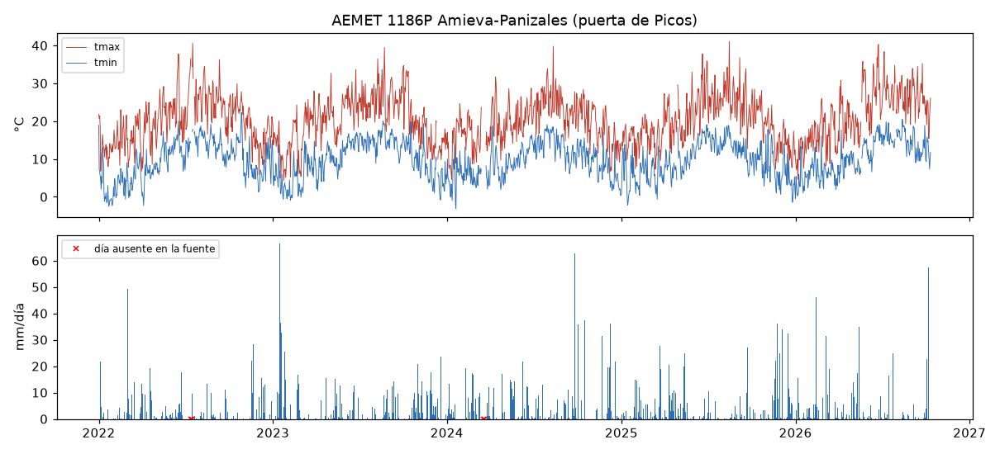
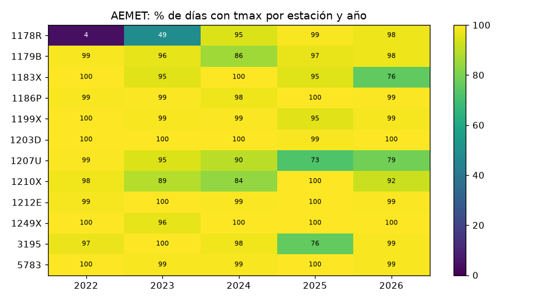
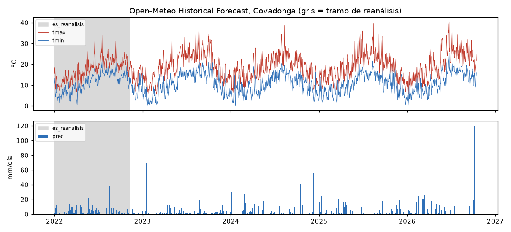
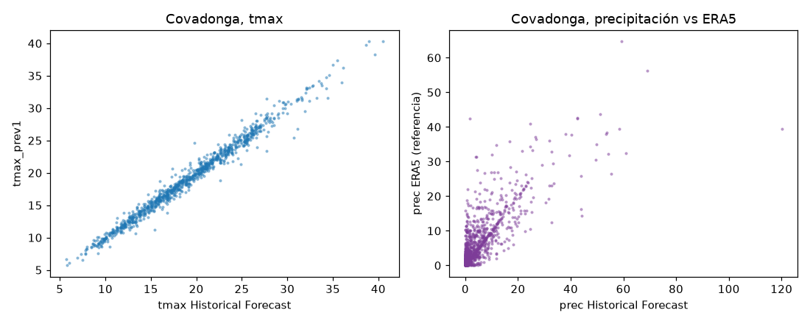
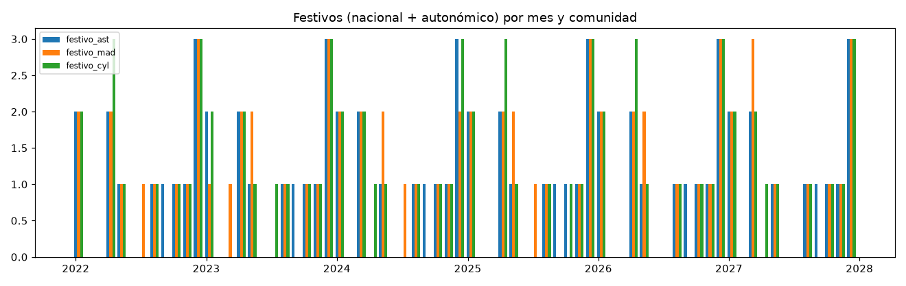
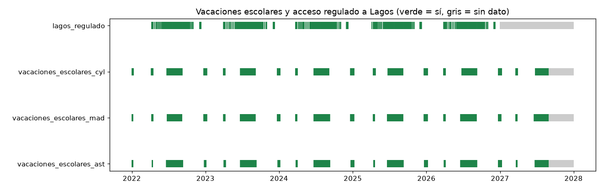
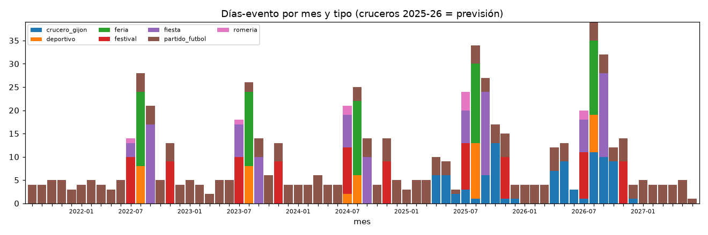
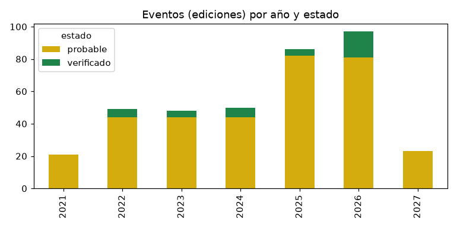
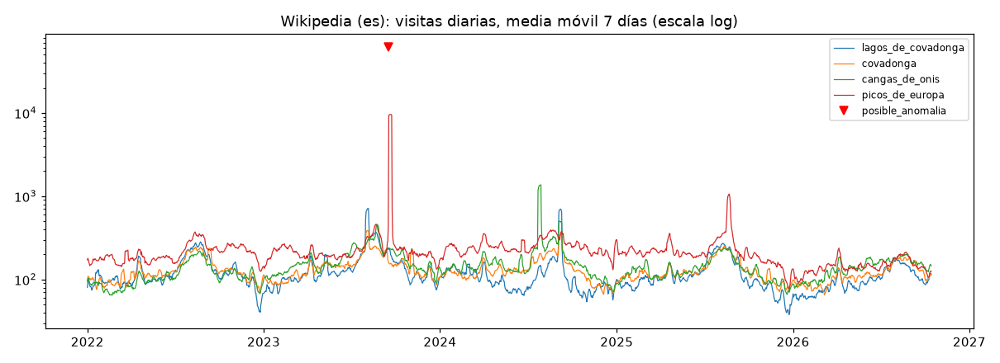
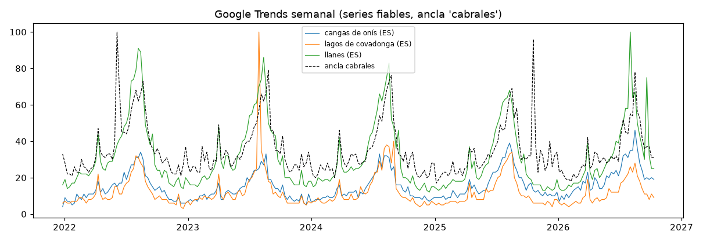

# Control de calidad de la parte B (limpieza, fase 2)

Generado por `python -X utf8 src/limpieza_B/control_calidad.py` (no editar a mano). Cada script de limpieza falla si encuentra duplicados por clave, fechas ausentes en series que deben ser continuas o valores fuera de rango; este informe recalcula las cifras desde las tablas de `data/clean/`. Significado de cada columna: `notas/diccionario_B.md`.

## Validaciones manuales

- Calendario: muestra aleatoria contrastada contra los PDF originales y comprobación de Semana Santa en `notas/validacion_calendario.md` (resumen abajo).
- Unión: `src/limpieza_B/test_unir_B.py` (datos sintéticos) y prueba con las tablas reales y `config/mapeo_zonas_ejemplo.csv` (IDs ficticios; tabla `factores_B_ejemplo` abajo).

Resumen de la validación del calendario: **Resultado: 16/16 coinciden.**

## Hallazgos de la limpieza (revisados a mano)

- **La muestra de fiestas locales de la auditoría (`auditoria_fase_B.md` §3.3) no es fiable.** El `.txt` de pdftotext desalinea las filas de la tabla del BOPA. Ejemplo: el texto pone «Cangas de Onís 16 de mayo San Isidro» (2022), pero la imagen del PDF da 13 de junio (San Antonio) y 25 de julio (Pastor). Lo he comprobado yo, renderizando la página. `festivos_locales` está validada contra la imagen del PDF, no contra el `.txt`.
- **Erratas en el BOPA**, conservadas y marcadas con `dia_semana_coherente=False`: Grado 2022-07-26 («lunes», pero fue martes) y Pravia 2024-09-06 («miércoles», pero fue viernes).
- **El tramo de reanálisis de Open-Meteo también es más frío en temperatura**: en Covadonga, la Tmax media de julio y agosto es 22,5 °C en 2022 frente a 24,8–25,8 °C en 2023–2026. En AEMET 1186P, el verano de 2022 es el más caluroso (26,5 °C). Ver la primera gráfica de Open-Meteo.
- El pico de 120 mm del 2026-10-07 en Covadonga es real: AEMET 1186P registra 57 mm y la previsión a 1 día daba 78 mm.
- Datos imposibles en la fuente, puestos a NaN y marcados: 206 valores negativos de `pintMax` en AEMET, 5 horas de racha imposibles y 1 hora de precipitación negativa en Previous Runs (2025-06-15, en 3 zonas).

## aemet_diario

`data/clean/aemet_diario.parquet` — **20.811 filas**, 38 columnas; clave `fecha, estacion`; duplicados por clave: **0**.
Rango: 2022-01-01 → 2026-10-11.
Fechas ausentes por `estacion` (dentro del rango de cada uno): **0 en todos**.

| Columna con NaN | % NaN |
|---|---|
| `dir_racha_codigo` | 90.47 |
| `hora_prec_max_intervalo` | 70.87 |
| `hora_pres_max` | 61.91 |
| `sol_h` | 61.25 |
| `hora_hr_max` | 54.68 |
| `hora_pres_min` | 50.77 |
| `pres_min_hpa` | 46.13 |
| `pres_max_hpa` | 46.12 |
| `dir_racha_grados` | 16.55 |
| `hora_racha` | 16.27 |
| `hora_hr_min` | 13.21 |
| `hora_tmin` | 12.80 |
| `prec_max_intervalo_mm` | 8.41 |
| `hora_tmax` | 8.14 |
| `racha_max_ms` | 7.02 |
| `hr_min_pct` | 6.69 |
| `hr_max_pct` | 6.68 |
| `tmed_c` | 6.27 |
| `tmax_c` | 6.27 |
| `tmin_c` | 6.27 |
| `viento_medio_ms` | 5.76 |
| `hr_media_pct` | 5.33 |
| `prec_inapreciable` | 4.20 |
| `prec_mm` | 4.20 |
| `prec_max_intervalo_negativo_en_fuente` | 4.20 |
| `hora_tmin_varias` | 4.20 |
| `hora_pres_max_varias` | 4.20 |
| `hora_racha_invalida_en_fuente` | 4.20 |
| `hora_racha_varias` | 4.20 |
| `hora_tmax_varias` | 4.20 |
| `hora_hr_max_varias` | 4.20 |
| `hora_pres_min_varias` | 4.20 |
| `hora_hr_min_varias` | 4.20 |
| `hora_prec_max_intervalo_varias` | 4.20 |

<details><summary>Comprobaciones específicas del script (data/clean/_qc/aemet_diario.json)</summary>

```json
{
 "fuente": "AEMET OpenData climatologías diarias",
 "estaciones": [
  "1178R",
  "1179B",
  "1183X",
  "1186P",
  "1199X",
  "1203D",
  "1207U",
  "1210X",
  "1212E",
  "1249X",
  "3195",
  "5783"
 ],
 "filas_presentes_en_fuente": 19937,
 "filas_ausentes_en_fuente": 874,
 "prec_inapreciable_dias": 331,
 "prec_max_intervalo_negativo_dias": 206,
 "dir_racha_codigo_99": 1979,
 "dir_racha_codigo_88": 5,
 "fechas_ausentes_tras_reindexar": {
  "1178R": 0,
  "1179B": 0,
  "1183X": 0,
  "1186P": 0,
  "1199X": 0,
  "1203D": 0,
  "1207U": 0,
  "1210X": 0,
  "1212E": 0,
  "1249X": 0,
  "3195": 0,
  "5783": 0
 },
 "huecos_por_estacion_variable": {
  "1178R": {
   "rango": [
    "2022-01-01",
    "2026-10-11"
   ],
   "dias": 1745,
   "filas_ausentes": 560,
   "vars": {
    "tmed_c": {
     "nan": 567,
     "pct": 32.5,
     "tramos_ge5": [
      [
       "2022-01-16",
       "2023-07-06",
       537
      ],
      [
       "2024-03-02",
       "2024-03-19",
       18
      ]
     ]
    },
    "tmin_c": {
     "nan": 567,
     "pct": 32.5,
     "tramos_ge5": [
      [
       "2022-01-16",
       "2023-07-06",
       537
      ],
      [
       "2024-03-02",
       "2024-03-19",
       18
      ]
     ]
    },
    "tmax_c": {
     "nan": 567,
     "pct": 32.5,
     "tramos_ge5": [
      [
       "2022-01-16",
       "2023-07-06",
       537
      ],
      [
       "2024-03-02",
       "2024-03-19",
       18
      ]
     ]
    },
    "prec_mm": {
     "nan": 560,
     "pct": 32.1,
     "tramos_ge5": [
      [
       "2022-01-16",
       "2023-07-06",
       537
      ],
      [
       "2024-03-02",
       "2024-03-19",
       18
      ]
     ]
    },
    "viento_medio_ms": {
     "nan": 569,
     "pct": 32.6,
     "tramos_ge5": [
      [
       "2022-01-16",
       "2023-07-06",
       537
      ],
      [
       "2024-03-02",
       "2024-03-19",
       18
      ]
     ]
    },
    "racha_max_ms": {
     "nan": 576,
     "pct": 33.0,
     "tramos_ge5": [
      [
       "2022-01-16",
       "2023-07-06",
       537
      ],
      [
       "2024-03-02",
       "2024-03-19",
       18
      ]
     ]
    },
    "sol_h": {
     "nan": 1745,
     "pct": 100.0,
     "tramos_ge5": [
      [
       "2022-01-01",
       "2026-10-11",
       1745
      ]
     ]
    },
    "hr_media_pct": {
     "nan": 562,
     "pct": 32.2,
     "tramos_ge5": [
      [
       "2022-01-16",
       "2023-07-06",
       537
      ],
      [
       "2024-03-02",
       "2024-03-19",
       18
      ]
     ]
    },
    "pres_max_hpa": {
     "nan": 573,
     "pct": 32.8,
     "tramos_ge5": [
      [
       "2022-01-16",
       "2023-07-06",
       537
      ],
      [
       "2024-03-02",
       "2024-03-19",
       18
      ]
     ]
    }
   }
  },
  "1179B": {
   "rango": [
    "2022-01-01",
    "2026-10-11"
   ],
   "dias": 1745,
   "filas_ausentes": 66,
   "vars": {
    "tmed_c": {
     "nan": 88,
     "pct": 5.0,
     "tramos_ge5": [
      [
       "2023-09-04",
       "2023-09-10",
 
… (recortado; completo en el JSON)
```
</details>




## openmeteo_diario

`data/clean/openmeteo_diario.parquet` — **15.741 filas**, 37 columnas; clave `fecha, zona_meteo`; duplicados por clave: **0**.
Rango: 2022-01-01 → 2026-10-15.
Fechas ausentes por `zona_meteo` (dentro del rango de cada uno): **0 en todos**.

| Columna con NaN | % NaN |
|---|---|
| `tmax_c_prev1` | 42.96 |
| `tmin_c_prev1` | 42.96 |
| `prec_mm_prev1` | 42.96 |
| `prec_horas_prev1` | 42.96 |
| `sol_s_prev1` | 42.96 |
| `viento_max_kmh_prev1` | 42.96 |
| `racha_max_kmh_prev1` | 42.96 |
| `weather_code_prev1` | 42.96 |
| `tmax_c_prev2` | 42.94 |
| `tmin_c_prev2` | 42.94 |
| `prec_mm_prev2` | 42.94 |
| `prec_horas_prev2` | 42.94 |
| `sol_s_prev2` | 42.94 |
| `viento_max_kmh_prev2` | 42.94 |
| `racha_max_kmh_prev2` | 42.94 |
| `weather_code_prev2` | 42.94 |
| `tmax_c_prev3` | 42.94 |
| `tmin_c_prev3` | 42.94 |
| `prec_mm_prev3` | 42.94 |
| `prec_horas_prev3` | 42.94 |
| `sol_s_prev3` | 42.94 |
| `viento_max_kmh_prev3` | 42.94 |
| `racha_max_kmh_prev3` | 42.94 |
| `weather_code_prev3` | 42.94 |

<details><summary>Comprobaciones específicas del script (data/clean/_qc/openmeteo_diario.json)</summary>

```json
{
 "zonas": [
  "cangas_de_onis",
  "covadonga",
  "gijon",
  "lagos_enol",
  "llanes",
  "madrid",
  "oviedo",
  "ribadesella",
  "sevilla"
 ],
 "fechas_ausentes_por_zona": {
  "cangas_de_onis": 0,
  "covadonga": 0,
  "gijon": 0,
  "lagos_enol": 0,
  "llanes": 0,
  "madrid": 0,
  "oviedo": 0,
  "ribadesella": 0,
  "sevilla": 0
 },
 "dias_es_reanalisis_por_zona": {
  "cangas_de_onis": 312,
  "covadonga": 312,
  "gijon": 312,
  "lagos_enol": 312,
  "llanes": 312,
  "madrid": 319,
  "oviedo": 312,
  "ribadesella": 312,
  "sevilla": 319
 },
 "dias_posiblemente_incompletos": [
  "2026-10-15"
 ],
 "primer_dia_prev": "2024-01-22",
 "meta_por_zona": {
  "covadonga": {
   "lat_respuesta": 43.31,
   "lon_respuesta": -5.06,
   "elevacion": 278.0,
   "fecha_descarga": "2026-10-15",
   "corte_reanalisis": "2022-11-09"
  },
  "lagos_enol": {
   "lat_respuesta": 43.27,
   "lon_respuesta": -4.9900002,
   "elevacion": 1070.0,
   "fecha_descarga": "2026-10-15",
   "corte_reanalisis": "2022-11-09"
  },
  "cangas_de_onis": {
   "lat_respuesta": 43.35,
   "lon_respuesta": -5.13,
   "elevacion": 70.0,
   "fecha_descarga": "2026-10-15",
   "corte_reanalisis": "2022-11-09"
  },
  "llanes": {
   "lat_respuesta": 43.42,
   "lon_respuesta": -4.75,
   "elevacion": 4.0,
   "fecha_descarga": "2026-10-15",
   "corte_reanalisis": "2022-11-09"
  },
  "ribadesella": {
   "lat_respuesta": 43.46,
   "lon_respuesta": -5.06,
   "elevacion": 11.0,
   "fecha_descarga": "2026-10-15",
   "corte_reanalisis": "2022-11-09"
  },
  "gijon": {
   "lat_respuesta": 43.53,
   "lon_respuesta": -5.6600003,
   "elevacion": 30.0,
   "fecha_descarga": "2026-10-15",
   "corte_reanalisis": "2022-11-09"
  },
  "oviedo": {
   "lat_respuesta": 43.36,
   "lon_respuesta": -5.86,
   "elevacion": 249.0,
   "fecha_descarga": "2026-10-15",
   "corte_reanalisis": "2022-11-09"
  },
  "madrid": {
   "lat_respuesta": 40.39599,
   "lon_respuesta": -3.6793447,
   "elevacion": 667.0,
   "fecha_descarga": "2026-10-15",
   "corte_reanalisis": "2022-11-16"
  },
  "sevilla": {
   "lat_respuesta": 37.364082,
   "lon_respuesta": -5.956622,
   "elevacion": 16.0,
   "fecha_descarga": "2026-10-15",
   "corte_reanalisis": "2022-11-16"
  }
 },
 "previous_valores_horarios_negativos_anulados": {
  "covadonga": {
   "precipitation_previous_day1": [
    "2025-06-15T12:00"
   ]
  },
  "lagos_enol": {},
  "cangas_de_onis": {},
  "llanes": {},
  "ribadesella": {},
  "gijon": {
   "precipitation_previous_day1": [
    "2025-06-15T12:00"
   ]
  },
  "oviedo": {
   "precipitation_previous_day1": [
    "2025-06-15T12:00"
   ]
  },
  "madrid": {},
  "sevilla": {}
 },
 "sanity_dia0_previous_vs_historical": {
  "covadonga": {
   "tmax_c": {
    "mae": 0.18,
    "pct_iguales_tol": 37.0,
    "corr": 0.9992
   },
   "tmin_c": {
    "mae": 0.2,
    "pct_iguales_tol": 30.4,
    "corr": 0.9983
   },
   "prec_mm": {
    "mae": 0.242,
    "pct_iguales_tol": 77.8,
    "corr": 0.9952
   },
   "prec_horas": {
    "mae": 0.001,
    "pct_iguales_tol": 99.9
… (recortado; completo en el JSON)
```
</details>




## openmeteo_era5_diario

`data/clean/openmeteo_era5_diario.parquet` — **15.741 filas**, 12 columnas; clave `fecha, zona_meteo`; duplicados por clave: **0**.
Rango: 2022-01-01 → 2026-10-15.
Fechas ausentes por `zona_meteo` (dentro del rango de cada uno): **0 en todos**.
Sin NaN en ninguna columna.

<details><summary>Comprobaciones específicas del script (data/clean/_qc/openmeteo_era5_diario.json)</summary>

```json
{
 "uso": "solo_referencia_no_entrenar",
 "sesgo_medio_historical_menos_era5_tras_corte": {
  "cangas_de_onis": {
   "tmax_c": 1.104,
   "tmin_c": 0.254,
   "prec_mm": -0.62
  },
  "covadonga": {
   "tmax_c": 0.366,
   "tmin_c": 0.574,
   "prec_mm": -0.956
  },
  "gijon": {
   "tmax_c": 1.332,
   "tmin_c": 1.572,
   "prec_mm": -0.797
  },
  "lagos_enol": {
   "tmax_c": -0.865,
   "tmin_c": -0.341,
   "prec_mm": 0.196
  },
  "llanes": {
   "tmax_c": -0.317,
   "tmin_c": -0.453,
   "prec_mm": -1.021
  },
  "madrid": {
   "tmax_c": 0.006,
   "tmin_c": 0.299,
   "prec_mm": -0.195
  },
  "oviedo": {
   "tmax_c": 1.245,
   "tmin_c": 1.878,
   "prec_mm": -1.166
  },
  "ribadesella": {
   "tmax_c": -0.164,
   "tmin_c": 0.65,
   "prec_mm": -0.395
  },
  "sevilla": {
   "tmax_c": 0.274,
   "tmin_c": -0.311,
   "prec_mm": -0.382
  }
 }
}
```
</details>

## openmeteo_prevision_ejemplo

`data/clean/openmeteo_prevision_ejemplo.parquet` — **7 filas**, 37 columnas; clave `fecha, zona_meteo`; duplicados por clave: **0**.
Rango: 2026-10-15 → 2026-10-21.
Fechas ausentes por `zona_meteo` (dentro del rango de cada uno): **0 en todos**.

| Columna con NaN | % NaN |
|---|---|
| `tmax_c_prev1` | 100.00 |
| `tmin_c_prev1` | 100.00 |
| `prec_mm_prev1` | 100.00 |
| `prec_horas_prev1` | 100.00 |
| `sol_s_prev1` | 100.00 |
| `viento_max_kmh_prev1` | 100.00 |
| `racha_max_kmh_prev1` | 100.00 |
| `weather_code_prev1` | 100.00 |
| `tmax_c_prev2` | 100.00 |
| `tmin_c_prev2` | 100.00 |
| `prec_mm_prev2` | 100.00 |
| `prec_horas_prev2` | 100.00 |
| `sol_s_prev2` | 100.00 |
| `viento_max_kmh_prev2` | 100.00 |
| `racha_max_kmh_prev2` | 100.00 |
| `weather_code_prev2` | 100.00 |
| `tmax_c_prev3` | 100.00 |
| `tmin_c_prev3` | 100.00 |
| `prec_mm_prev3` | 100.00 |
| `prec_horas_prev3` | 100.00 |
| `sol_s_prev3` | 100.00 |
| `viento_max_kmh_prev3` | 100.00 |
| `racha_max_kmh_prev3` | 100.00 |
| `weather_code_prev3` | 100.00 |

<details><summary>Comprobaciones específicas del script (data/clean/_qc/openmeteo_prevision_ejemplo.json)</summary>

```json
{
 "zona_identificada_por_coordenadas": "covadonga",
 "esquema_igual_a_openmeteo_diario": true
}
```
</details>

## calendario_diario

`data/clean/calendario_diario.parquet` — **2.191 filas**, 52 columnas; clave `fecha`; duplicados por clave: **0**.
Rango: 2022-01-01 → 2027-12-31.
Fechas ausentes en el rango: **0**.

| Columna con NaN | % NaN |
|---|---|
| `lagos_incidencia` | 98.54 |
| `lagos_incidencia_fuente` | 98.54 |
| `lagos_incidencia_verificado` | 98.54 |
| `nombre_festivo_nacional` | 97.63 |
| `tipo_festivo_mad` | 96.71 |
| `nombre_festivo_cyl` | 96.71 |
| `tipo_festivo_cyl` | 96.71 |
| `nombre_festivo_mad` | 96.71 |
| `tipo_festivo_ast` | 96.71 |
| `nombre_festivo_ast` | 96.71 |
| `lagos_horario` | 59.06 |
| `lagos_regulado_fuente` | 16.66 |
| `lagos_regulado` | 16.66 |
| `escolar_fuente_ast` | 5.57 |
| `no_lectivo_ast` | 5.57 |
| `vacaciones_escolares_ast` | 5.57 |
| `periodo_escolar_ast` | 5.57 |
| `escolar_verificado_ast` | 5.57 |
| `periodo_escolar_mad` | 5.57 |
| `vacaciones_escolares_mad` | 5.57 |
| `no_lectivo_cyl` | 5.57 |
| `vacaciones_escolares_cyl` | 5.57 |
| `periodo_escolar_cyl` | 5.57 |
| `escolar_fuente_mad` | 5.57 |
| `escolar_verificado_mad` | 5.57 |
| `no_lectivo_mad` | 5.57 |
| `escolar_verificado_cyl` | 5.57 |
| `escolar_fuente_cyl` | 5.57 |

<details><summary>Comprobaciones específicas del script (data/clean/_qc/calendario_diario.json)</summary>

```json
{
 "festivos_por_anio": {
  "ast": {
   "2022": 12,
   "2023": 12,
   "2024": 12,
   "2025": 12,
   "2026": 12,
   "2027": 12
  },
  "mad": {
   "2022": 12,
   "2023": 12,
   "2024": 12,
   "2025": 12,
   "2026": 12,
   "2027": 12
  },
  "cyl": {
   "2022": 12,
   "2023": 12,
   "2024": 12,
   "2025": 12,
   "2026": 12,
   "2027": 12
  }
 },
 "puentes_por_anio": {
  "ast": {
   "2022": 6,
   "2023": 3,
   "2024": 1,
   "2025": 2,
   "2026": 3,
   "2027": 2
  },
  "mad": {
   "2022": 5,
   "2023": 3,
   "2024": 3,
   "2025": 1,
   "2026": 2,
   "2027": 2
  },
  "cyl": {
   "2022": 5,
   "2023": 4,
   "2024": 2,
   "2025": 2,
   "2026": 3,
   "2027": 2
  }
 },
 "lagos_regulado_por_anio": {
  "2022": 173,
  "2023": 175,
  "2024": 180,
  "2025": 184,
  "2026": 185
 },
 "semana_santa_ok": true
}
```
</details>




## festivos_locales

`data/clean/festivos_locales.parquet` — **1.024 filas**, 10 columnas; clave `fecha, concejo`; duplicados por clave: **0**.
Rango: 2022-01-17 → 2027-12-13.
Fechas ausentes: no aplica (tabla de sucesos, no serie continua).

| Columna con NaN | % NaN |
|---|---|
| `dia_semana_coherente` | 83.01 |
| `festivo_parcial` | 6.74 |
| `nombre` | 5.86 |

<details><summary>Comprobaciones específicas del script (data/clean/_qc/festivos_locales.json)</summary>

```json
{
 "filas_por_anio": {
  "2022": 171,
  "2023": 171,
  "2024": 170,
  "2025": 170,
  "2026": 171,
  "2027": 171
 },
 "concejos_por_anio": {
  "2022": 78,
  "2023": 78,
  "2024": 78,
  "2025": 78,
  "2026": 78,
  "2027": 78
 }
}
```
</details>

## eventos_diario

`data/clean/eventos_diario.parquet` — **674 filas**, 31 columnas; clave `fecha, concejo, evento`; duplicados por clave: **0**.
Rango: 2021-08-15 → 2027-06-06.
Fechas ausentes: no aplica (tabla de sucesos, no serie continua).

| Columna con NaN | % NaN |
|---|---|
| `aforo` | 100.00 |
| `nota_calidad` | 97.48 |
| `es_prevision` | 86.65 |
| `pasajeros_capacidad` | 86.65 |
| `hora_partido` | 67.21 |
| `rival` | 62.91 |
| `club_local` | 62.91 |
| `competicion` | 62.91 |
| `temporada` | 62.91 |
| `categoria_temporada` | 62.91 |
| `calendario_confirmado` | 62.91 |
| `hora_ini` | 41.10 |
| `lugar` | 5.34 |

<details><summary>Comprobaciones específicas del script (data/clean/_qc/eventos_diario.json)</summary>

```json
{
 "filas_csv_origen": 378,
 "filas_sin_fecha_no_expandidas": 4,
 "por_tipo": {
  "partido_futbol": 250,
  "fiesta": 104,
  "festival": 95,
  "crucero_gijon": 90,
  "feria": 81,
  "deportivo": 44,
  "romeria": 10
 },
 "por_estado": {
  "probable": 403,
  "verificado": 271
 },
 "eventos_por_estado_origen": {
  "probable": 339,
  "verificado": 35,
  "no_encontrado": 4
 },
 "cruceros_escalas": 90,
 "cruceros_anios": [
  2025,
  2026
 ],
 "partidos_calendario_no_confirmado": 29,
 "validaciones": [
  "sin duplicados (fecha, concejo, evento)",
  "fecha_fin >= fecha_ini",
  "estados y fuente_tipo válidos",
  "nº de filas expandidas = suma de duraciones",
  "cruceros solo 2025-2026 y todos previsión",
  "hora HH:MM"
 ]
}
```
</details>




## partidos_diario

`data/clean/partidos_diario.parquet` — **2.122 filas**, 16 columnas; clave `fecha`; duplicados por clave: **0**.
Rango: 2021-08-15 → 2027-06-06.
Fechas ausentes en el rango: **0**.

| Columna con NaN | % NaN |
|---|---|
| `hora_partido_oviedo` | 94.86 |
| `hora_partido_sporting` | 94.72 |
| `estado_partido_oviedo` | 94.16 |
| `rival_oviedo` | 94.16 |
| `calendario_confirmado_oviedo` | 94.16 |
| `rival_sporting` | 94.06 |
| `estado_partido_sporting` | 94.06 |
| `calendario_confirmado_sporting` | 94.06 |

<details><summary>Comprobaciones específicas del script (data/clean/_qc/partidos_diario.json)</summary>

```json
{
 "dias_partido_oviedo": 124,
 "dias_partido_sporting": 126,
 "dias_con_ambos": 16,
 "derbis": 10
}
```
</details>

## wikipedia_diario

`data/clean/wikipedia_diario.parquet` — **34.960 filas**, 13 columnas; clave `fecha, articulo`; duplicados por clave: **0**.
Rango: 2022-01-01 → 2026-10-14.
Fechas ausentes por `articulo` (dentro del rango de cada uno): **0 en todos**.

| Columna con NaN | % NaN |
|---|---|
| `visitas_api` | 1.80 |
| `visitas_media7_ant` | 0.40 |
| `media7_ant_n_imputados` | 0.40 |

<details><summary>Comprobaciones específicas del script (data/clean/_qc/wikipedia_diario.json)</summary>

```json
{
 "articulos": 20,
 "dias_imputados_por_articulo": {
  "covadonga_fr": 630,
  "parque_nacional_de_los_picos_de_europa": 1
 },
 "ceros_explicitos_api": {
  "covadonga_fr": 405,
  "descenso_internacional_del_sella": 1,
  "parque_nacional_de_los_picos_de_europa": 7
 },
 "sonda": {
  "Lago_de_la_Ercina_2022": "HTTP 200 con 296 de 365 días (la API omite días)",
  "Mirador_de_Entrelagos_2022": "HTTP 404 (sin datos en todo el rango)"
 },
 "dias_pico": 14,
 "posibles_anomalias": [
  {
   "articulo": "picos_de_europa",
   "fecha": "2023-09-17",
   "visitas": "61525"
  }
 ],
 "validaciones": [
  "continuidad 2022-01-01..2026-10-14 por artículo",
  "sin duplicados",
  "visitas >= 0",
  "imputados y ceros = recuentos de la auditoría",
  "3 valores contrastados en vivo por la auditoría (Covadonga 2023-09-17=193, Lagos 2025-08-15=169, Picos 2024-06-01=191)"
 ]
}
```
</details>



## oapn_anual

`data/clean/oapn_anual.csv` — **11 filas**, 10 columnas; clave `anio`; duplicados por clave: **0**.
Sin NaN en ninguna columna.

<details><summary>Comprobaciones específicas del script (data/clean/_qc/oapn_anual.json)</summary>

```json
{
 "anio_min": 2015,
 "anio_max": 2025,
 "verificados": 11,
 "no_verificados": [],
 "validaciones": [
  "cifra extraída del PDF = cifra de notas/notas_senales.md"
 ]
}
```
</details>

## trends_semanal

`data/clean/trends_semanal.parquet` — **753 filas**, 15 columnas; clave `semana_inicio, termino, geo`; duplicados por clave: **0**.
Rango: 2021-12-26 → 2026-10-11.
Fechas ausentes: no aplica (tabla de sucesos, no serie continua).
Sin NaN en ninguna columna.

<details><summary>Comprobaciones específicas del script (data/clean/_qc/trends_semanal.json)</summary>

```json
{
 "series": [
  {
   "termino": "cangas de onís",
   "geo": "ES",
   "ancla": "cabrales",
   "semanas": "251",
   "mediana": "13.0",
   "maximo": "46",
   "semanas_cero": "0"
  },
  {
   "termino": "lagos de covadonga",
   "geo": "ES",
   "ancla": "cabrales",
   "semanas": "251",
   "mediana": "9.0",
   "maximo": "100",
   "semanas_cero": "0"
  },
  {
   "termino": "llanes",
   "geo": "ES",
   "ancla": "cabrales",
   "semanas": "251",
   "mediana": "24.0",
   "maximo": "100",
   "semanas_cero": "0"
  }
 ],
 "n_series": 3,
 "csv_manuales": 0,
 "validaciones": [
  "sin duplicados",
  "valores 0-100",
  "semanas contiguas de 7 días",
  "ancla = primer término de kw_list"
 ]
}
```
</details>



## trends_semanal_no_fiable

`data/clean/trends_semanal_no_fiable.parquet` — **2.259 filas**, 15 columnas; clave `semana_inicio, termino, geo`; duplicados por clave: **0**.
Rango: 2021-12-26 → 2026-10-11.
Fechas ausentes: no aplica (tabla de sucesos, no serie continua).
Sin NaN en ninguna columna.

<details><summary>Comprobaciones específicas del script (data/clean/_qc/trends_semanal_no_fiable.json)</summary>

```json
{
 "series": [
  {
   "termino": "cangas de onís",
   "geo": "ES",
   "ancla": "picos de europa",
   "semanas": "251",
   "mediana": "1.0",
   "maximo": "3",
   "semanas_cero": "22"
  },
  {
   "termino": "cangas de onís",
   "geo": "ES-MD",
   "ancla": "picos de europa",
   "semanas": "251",
   "mediana": "0.0",
   "maximo": "2",
   "semanas_cero": "137"
  },
  {
   "termino": "covadonga",
   "geo": "ES",
   "ancla": "picos de europa",
   "semanas": "251",
   "mediana": "5.0",
   "maximo": "37",
   "semanas_cero": "0"
  },
  {
   "termino": "lagos de covadonga",
   "geo": "ES",
   "ancla": "picos de europa",
   "semanas": "251",
   "mediana": "1.0",
   "maximo": "16",
   "semanas_cero": "0"
  },
  {
   "termino": "lagos de covadonga",
   "geo": "ES-MD",
   "ancla": "picos de europa",
   "semanas": "251",
   "mediana": "1.0",
   "maximo": "17",
   "semanas_cero": "16"
  },
  {
   "termino": "llanes",
   "geo": "ES",
   "ancla": "picos de europa",
   "semanas": "251",
   "mediana": "9.0",
   "maximo": "38",
   "semanas_cero": "0"
  },
  {
   "termino": "llanes",
   "geo": "ES-MD",
   "ancla": "picos de europa",
   "semanas": "251",
   "mediana": "7.0",
   "maximo": "33",
   "semanas_cero": "0"
  },
  {
   "termino": "ruta del cares",
   "geo": "ES",
   "ancla": "picos de europa",
   "semanas": "251",
   "mediana": "1.0",
   "maximo": "4",
   "semanas_cero": "76"
  },
  {
   "termino": "ruta del cares",
   "geo": "ES-MD",
   "ancla": "picos de europa",
   "semanas": "251",
   "mediana": "1.0",
   "maximo": "4",
   "semanas_cero": "84"
  }
 ],
 "n_series": 9,
 "csv_manuales": 0,
 "validaciones": [
  "sin duplicados",
  "valores 0-100",
  "semanas contiguas de 7 días",
  "ancla = primer término de kw_list"
 ]
}
```
</details>

## factores_B_ejemplo (prueba unir_B)

`data/clean/_prueba/factores_B_ejemplo.parquet` — **8.745 filas**, 186 columnas; clave `fecha, zona_mitma_id`; duplicados por clave: **0**.
Rango: 2022-01-01 → 2026-10-15.
Fechas ausentes por `zona_mitma_id` (dentro del rango de cada uno): **0 en todos**.

| Columna con NaN | % NaN |
|---|---|
| `crucero_pasajeros_prevision` | 99.12 |
| `festivo_local_nombre` | 98.86 |
| `lagos_incidencia` | 98.17 |
| `lagos_incidencia_verificado` | 98.17 |
| `lagos_incidencia_fuente` | 98.17 |
| `nombre_festivo_nacional` | 97.66 |
| `nombre_festivo_cyl` | 96.80 |
| `tipo_festivo_cyl` | 96.80 |
| `nombre_festivo_mad` | 96.80 |
| `tipo_festivo_mad` | 96.80 |
| `tipo_festivo_ast` | 96.80 |
| `nombre_festivo_ast` | 96.80 |
| `futbol_calendario_confirmado_oviedo` | 94.45 |
| `futbol_hora_partido_oviedo` | 94.45 |
| `futbol_calendario_confirmado_sporting` | 94.28 |
| `futbol_hora_partido_sporting` | 94.28 |
| `om_montana_racha_max_kmh_prev1` | 88.59 |
| `om_montana_weather_code_prev1` | 88.59 |
| `om_montana_prec_mm_prev1` | 88.59 |
| `om_montana_tmin_c_prev1` | 88.59 |
| `om_montana_tmax_c_prev1` | 88.59 |
| `om_montana_weather_code_prev2` | 88.59 |
| `om_montana_racha_max_kmh_prev2` | 88.59 |
| `om_montana_viento_max_kmh_prev2` | 88.59 |
| `om_montana_sol_s_prev2` | 88.59 |
| `om_montana_prec_horas_prev2` | 88.59 |
| `om_montana_prec_mm_prev2` | 88.59 |
| `om_montana_tmin_c_prev3` | 88.59 |
| `om_montana_tmax_c_prev3` | 88.59 |
| `om_montana_tmin_c_prev2` | 88.59 |
| `om_montana_tmax_c_prev2` | 88.59 |
| `om_montana_weather_code_prev3` | 88.59 |
| `om_montana_racha_max_kmh_prev3` | 88.59 |
| `om_montana_prec_horas_prev3` | 88.59 |
| `om_montana_prec_mm_prev3` | 88.59 |
| `om_montana_viento_max_kmh_prev3` | 88.59 |
| `om_montana_sol_s_prev3` | 88.59 |
| `om_montana_prec_horas_prev1` | 88.59 |
| `om_montana_sol_s_prev1` | 88.59 |
| `om_montana_viento_max_kmh_prev1` | 88.59 |
| `om_montana_viento_max_kmh` | 80.00 |
| `om_montana_sol_s` | 80.00 |
| `om_montana_weather_code` | 80.00 |
| `om_montana_tmin_c` | 80.00 |
| `om_montana_tmax_c` | 80.00 |
| `om_montana_dia_posiblemente_incompleto` | 80.00 |
| `om_montana_es_reanalisis` | 80.00 |
| `om_montana_prec_mm` | 80.00 |
| `om_montana_prec_horas` | 80.00 |
| `om_montana_racha_max_kmh` | 80.00 |
| `zona_meteo_montana` | 80.00 |
| `lagos_horario` | 49.63 |
| `aemet_sol_h` | 46.34 |
| `aemet_pres_min_hpa` | 44.44 |
| `aemet_pres_max_hpa` | 44.41 |
| `om_tmax_c_prev1` | 42.96 |
| `om_tmin_c_prev1` | 42.96 |
| `om_racha_max_kmh_prev1` | 42.96 |
| `om_viento_max_kmh_prev1` | 42.96 |
| `om_weather_code_prev1` | 42.96 |
| `om_prec_horas_prev1` | 42.96 |
| `om_prec_mm_prev1` | 42.96 |
| `om_sol_s_prev1` | 42.96 |
| `om_weather_code_prev3` | 42.94 |
| `om_prec_horas_prev3` | 42.94 |
| `om_sol_s_prev3` | 42.94 |
| `om_viento_max_kmh_prev3` | 42.94 |
| `om_racha_max_kmh_prev3` | 42.94 |
| `om_weather_code_prev2` | 42.94 |
| `om_tmax_c_prev3` | 42.94 |
| `om_tmax_c_prev2` | 42.94 |
| `om_prec_mm_prev2` | 42.94 |
| `om_tmin_c_prev2` | 42.94 |
| `om_sol_s_prev2` | 42.94 |
| `om_viento_max_kmh_prev2` | 42.94 |
| `om_racha_max_kmh_prev2` | 42.94 |
| `om_prec_horas_prev2` | 42.94 |
| `om_prec_mm_prev3` | 42.94 |
| `om_tmin_c_prev3` | 42.94 |
| `aemet_dir_racha_grados` | 29.82 |
| `aemet_prec_max_intervalo_mm` | 26.74 |
| `aemet_racha_max_ms` | 26.12 |
| `aemet_hr_min_pct` | 24.30 |
| `aemet_hr_max_pct` | 24.30 |
| `aemet_tmax_c` | 24.29 |
| `aemet_tmed_c` | 24.29 |
| `aemet_tmin_c` | 24.29 |
| `aemet_viento_medio_ms` | 23.82 |
| `aemet_hr_media_pct` | 22.22 |
| `aemet_prec_inapreciable` | 21.76 |
| `aemet_prec_mm` | 21.76 |
| `aemet_prec_max_intervalo_negativo_en_fuente` | 21.76 |
| `aemet_fila_ausente_en_fuente` | 20.18 |
| `estacion_aemet` | 20.00 |
| `wiki_cabrales_media7_ant` | 0.46 |
| `wiki_cangas_de_onis_media7_ant` | 0.46 |
| `wiki_covadonga_media7_ant` | 0.46 |
| `wiki_covadonga_en_media7_ant` | 0.46 |
| `wiki_covadonga_fr_media7_ant` | 0.46 |
| `wiki_descenso_internacional_del_sella_media7_ant` | 0.46 |
| `wiki_fuente_de_media7_ant` | 0.46 |
| `wiki_gijon_media7_ant` | 0.46 |
| `wiki_lagos_de_covadonga_media7_ant` | 0.46 |
| `wiki_llanes_media7_ant` | 0.46 |
| `wiki_oviedo_media7_ant` | 0.46 |
| `wiki_parque_nacional_de_los_picos_de_europa_media7_ant` | 0.46 |
| `wiki_picos_de_europa_media7_ant` | 0.46 |
| `wiki_picos_de_europa_en_media7_ant` | 0.46 |
| `wiki_picos_de_europa_national_park_en_media7_ant` | 0.46 |
| `wiki_pics_d_europe_fr_media7_ant` | 0.46 |
| `wiki_potes_media7_ant` | 0.46 |
| `wiki_ribadesella_media7_ant` | 0.46 |
| `wiki_ruta_del_cares_media7_ant` | 0.46 |
| `wiki_santa_cueva_de_covadonga_media7_ant` | 0.46 |
| `trends_cangas_de_onis_ES_sem_ant` | 0.06 |
| `trends_lagos_de_covadonga_ES_sem_ant` | 0.06 |
| `trends_llanes_ES_sem_ant` | 0.06 |
