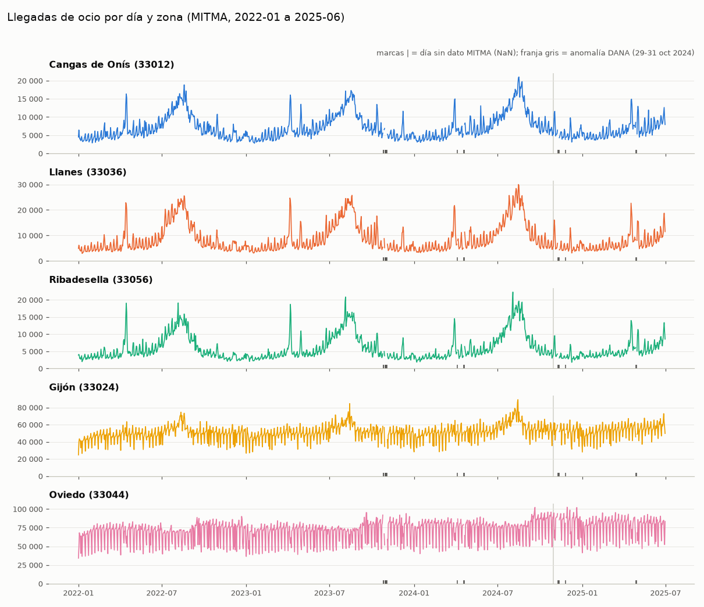

# Revisión rápida del objetivo (`data/clean/objetivo_diario.parquet`)

Generado con `src/modelo/revision_objetivo.py`. Periodo 2022-01-01 a 2025-06-30, 5 zonas MITMA (una por zona del mapeo). Es una revisión rápida, no el análisis completo.

## 1. Serie diaria de llegadas de ocio

Una escala por zona (las zonas no son comparables en magnitud). Los huecos de la línea son días sin dato (NaN, nunca 0); las marcas `|` en la base los señalan; la franja gris es la anomalía de la DANA.

## 2. «Día normal» por zona

Mediana de `llegadas_ocio` por día de la semana, **solo 2024, sin julio, agosto ni festivos de Asturias** y solo días con calidad `completa`. Días que entran en cada mediana (zona de los Picos): lunes 40, martes 42, miércoles 40, jueves 39, viernes 39, sábado 40, domingo 43.

| zona | lunes | martes | miércoles | jueves | viernes | sábado | domingo |
|---|---|---|---|---|---|---|---|
| Cangas de Onís | 4 948 | 5 295 | 5 327 | 5 343 | 6 305 | 7 169 | 6 800 |
| Llanes | 4 831 | 5 165 | 4 978 | 5 580 | 7 856 | 9 019 | 6 861 |
| Ribadesella | 3 571 | 3 558 | 3 793 | 4 115 | 4 746 | 5 716 | 4 372 |
| Gijón | 50 519 | 50 932 | 52 478 | 53 929 | 60 190 | 51 079 | 40 349 |
| Oviedo | 79 133 | 80 500 | 82 068 | 82 845 | 87 142 | 67 886 | 50 064 |

## 3. Los 20 días más altos de la zona de los Picos (Cangas de Onís, `33012`)

| # | fecha | día | llegadas_ocio | desde Asturias | resto de España | qué es |
|---|---|---|---|---|---|---|
| 1 | 2024-08-16 | viernes | 21 014 | 4 955 | 16 059 | agosto, puente |
| 2 | 2024-08-15 | jueves | 20 784 | 5 141 | 15 643 | agosto, festivo AST |
| 3 | 2024-08-23 | viernes | 19 724 | 5 063 | 14 661 | agosto |
| 4 | 2024-08-17 | sábado | 19 431 | 5 325 | 14 107 | agosto, fin de semana |
| 5 | 2024-08-22 | jueves | 19 378 | 4 980 | 14 398 | agosto |
| 6 | 2024-08-14 | miércoles | 19 211 | 4 812 | 14 400 | agosto |
| 7 | 2022-08-19 | viernes | 18 848 | 5 019 | 13 829 | agosto |
| 8 | 2024-08-19 | lunes | 18 313 | 4 548 | 13 765 | agosto |
| 9 | 2024-08-21 | miércoles | 18 209 | 4 834 | 13 375 | agosto |
| 10 | 2024-08-20 | martes | 17 827 | 4 446 | 13 381 | agosto |
| 11 | 2024-08-08 | jueves | 17 641 | 4 624 | 13 017 | agosto |
| 12 | 2023-08-17 | jueves | 17 299 | 4 369 | 12 930 | agosto |
| 13 | 2024-08-10 | sábado | 17 236 | 5 378 | 11 858 | agosto, fin de semana |
| 14 | 2022-08-23 | martes | 17 170 | 5 380 | 11 790 | agosto |
| 15 | 2023-08-05 | sábado | 17 144 | 6 422 | 10 723 | agosto, fin de semana |
| 16 | 2023-08-18 | viernes | 16 933 | 4 455 | 12 478 | agosto |
| 17 | 2024-08-09 | viernes | 16 923 | 4 901 | 12 022 | agosto |
| 18 | 2022-08-18 | jueves | 16 842 | 4 201 | 12 641 | agosto |
| 19 | 2023-08-19 | sábado | 16 785 | 5 311 | 11 474 | agosto, fin de semana |
| 20 | 2024-08-13 | martes | 16 638 | 4 692 | 11 947 | agosto |

Resumen de esos 20 días: agosto 20, Semana Santa 0, festivo 1, puente o finde largo 1, sábado/domingo 4. (Las etiquetas salen del calendario de la parte B: `semana_santa`, `festivo_ast`, `puente_ast`, `finde_largo_ast`, `es_fin_de_semana`.)

## 4. Días sin dato: NaN y no 0

- Días `sin_dato_mitma` (16): 2023-10-26, 2023-10-27, 2023-10-30, 2023-10-31, 2023-11-01, 2023-11-02, 2023-11-03, 2024-04-04, 2024-04-18, 2024-04-19, 2024-11-09, 2024-11-10, 2024-11-11, 2024-11-26, 2025-04-28, 2025-04-29.
- En esos días las 7 columnas de valores son NaN en las 5 zonas: **sí** · ceros en esos días: **0** · NaN en días con dato: **0**.
- Ceros reales (días con fichero y zona sin viajes): 0.
- `anomalia_mitma` (29-31 oct 2024, se conservan los valores): 15 filas.
- **Atención:** `config/mitma_calidad.yaml` marca como `sin_dato_mitma` los días 2024-04-04, 2024-04-19 y 2024-11-11, **aunque el portal sí los publicó** (están en los ficheros descargados). Quedan en NaN por esa configuración. Además faltan en el portal 2024-11-09 y 2024-11-26 (no están en la lista oficial; también quedan NaN). Ver `notas/cobertura_mitma.md`.

## 5. Quién llega a los Picos (Cangas de Onís, días `completa`)

Media diaria por año. Asturias frente al resto de España se calcula sobre llegadas de **ocio** (decisión del equipo); los no residentes en España no aparecen en el MITMA.

| año | días | llegadas_ocio | desde Asturias | resto de España | total desde Asturias | total resto de España | pernoctaciones no residentes | % Asturias (ocio) | % resto de España (ocio) |
|---|---|---|---|---|---|---|---|---|---|
| 2022 | 365 | 6 939 | 3 980 | 2 960 | 7 315 | 2 965 | 2 160 | 57 | 43 |
| 2023 | 358 | 7 117 | 3 924 | 3 193 | 7 264 | 3 197 | 2 352 | 55 | 45 |
| 2024 | 356 | 7 599 | 4 088 | 3 511 | 7 805 | 3 514 | 2 410 | 54 | 46 |
| 2025 | 179 | 6 435 | 4 263 | 2 171 | 8 452 | 2 176 | 1 544 | 66 | 34 |

**Excursionistas frente a pernoctantes (indicativo).** El MITMA no da esa partición directamente. Se comparan dos magnitudes distintas, no comparables como partes de un todo: personas que pernoctan en la zona y viven fuera (`pernoctaciones_no_residentes`, un stock diario) y llegadas de ocio (un flujo). Media diaria de 2024 por mes:

| mes | llegadas_ocio | desde Asturias | resto de España | pernoctantes no residentes | pernoctantes ÷ llegadas de ocio | % Asturias (ocio) |
|---|---|---|---|---|---|---|
| ene | 4 036.9 | 3 228.0 | 808.9 | 789.8 | 0.2 | 80.0 |
| feb | 4 506.0 | 3 458.5 | 1 047.5 | 835.6 | 0.2 | 76.8 |
| mar | 6 602.4 | 3 789.6 | 2 812.8 | 1 955.7 | 0.3 | 57.4 |
| abr | 6 034.8 | 3 906.0 | 2 128.8 | 1 560.3 | 0.3 | 64.7 |
| may | 6 894.0 | 4 265.0 | 2 628.9 | 1 818.9 | 0.3 | 61.9 |
| jun | 7 833.8 | 4 272.4 | 3 561.4 | 2 632.6 | 0.3 | 54.5 |
| jul | 11 202.7 | 4 492.5 | 6 710.2 | 4 423.5 | 0.4 | 40.1 |
| ago | 16 337.9 | 4 837.8 | 11 500.1 | 7 189.5 | 0.4 | 29.6 |
| sep | 9 092.4 | 4 594.3 | 4 498.1 | 3 052.6 | 0.3 | 50.5 |
| oct | 6 887.0 | 4 360.1 | 2 526.9 | 1 778.5 | 0.3 | 63.3 |
| nov | 5 688.6 | 3 961.8 | 1 726.8 | 1 216.3 | 0.2 | 69.6 |
| dic | 5 347.3 | 3 854.0 | 1 493.3 | 1 227.8 | 0.2 | 72.1 |

En los Picos el cociente va de 0.19 (invierno) a 0.44 (verano). No es «la proporción de pernoctantes»: el numerador cuenta personas que duermen en la zona (incluidos asturianos de otras zonas y estancias de varios días) y el denominador, llegadas de un día. **NO VERIFICADO** que esta comparación sirva para separar excursionistas de pernoctantes; hace falta una definición de la sesión del modelo. Nota: 2025 solo tiene enero-junio, así que su reparto (más peso de Asturias) no es comparable con los años completos.

## 6. Cosas raras / a vigilar

- Cangas de Onís: llegadas_ocio diarias entre 2 789 y 21 014; pernoctaciones_no_residentes máx. 10 157 (2024-08-18).
- Llanes: llegadas_ocio diarias entre 2 954 y 29 998; pernoctaciones_no_residentes máx. 32 569 (2024-08-17).
- Ribadesella: llegadas_ocio diarias entre 1 807 y 22 266; pernoctaciones_no_residentes máx. 19 522 (2024-08-03).
- Gijón: llegadas_ocio diarias entre 24 683 y 89 199; pernoctaciones_no_residentes máx. 285 122 (2023-08-15).
- Oviedo: llegadas_ocio diarias entre 34 175 y 102 494; pernoctaciones_no_residentes máx. 224 451 (2024-12-20).
- `llegadas_resto_espana / llegadas_total_resto_espana` (todas las zonas y días): 0.895–1.000. Los visitantes de fuera de Asturias casi siempre cuentan como ocio por construcción del MITMA (su «actividad frecuente» es la de su residencia), así que ambos repartos son casi iguales para el resto de España.
- `pernoctaciones_no_residentes` cuenta cualquier persona cuya zona de residencia es distinta de la de pernoctación, incluidos asturianos de otras zonas: no es «turistas».
- El MITMA solo cubre residentes en España y la unidad mínima es el municipio: Covadonga y Lagos no se pueden separar de Cangas de Onís.
